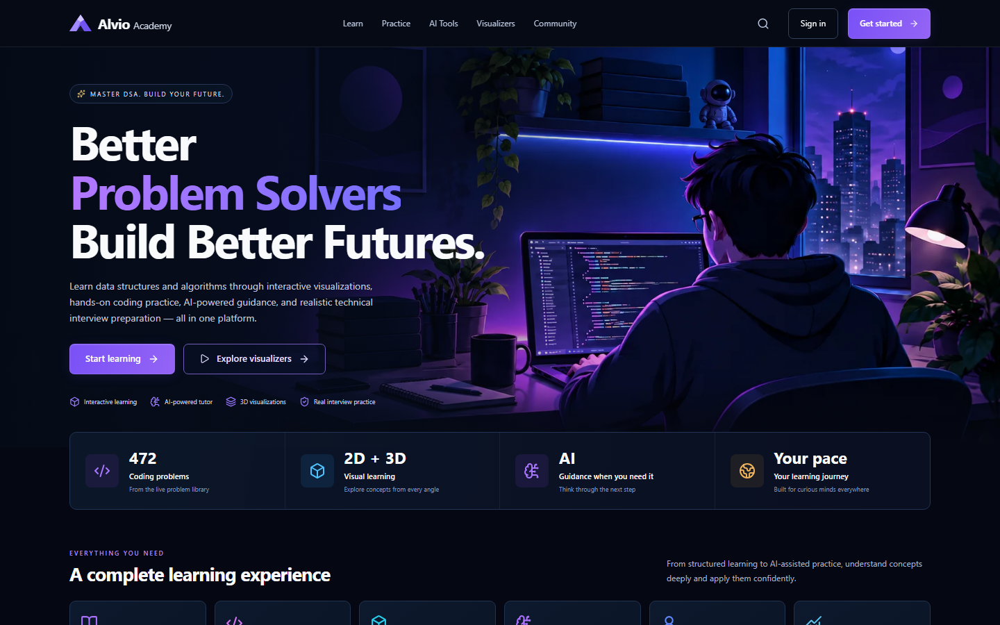
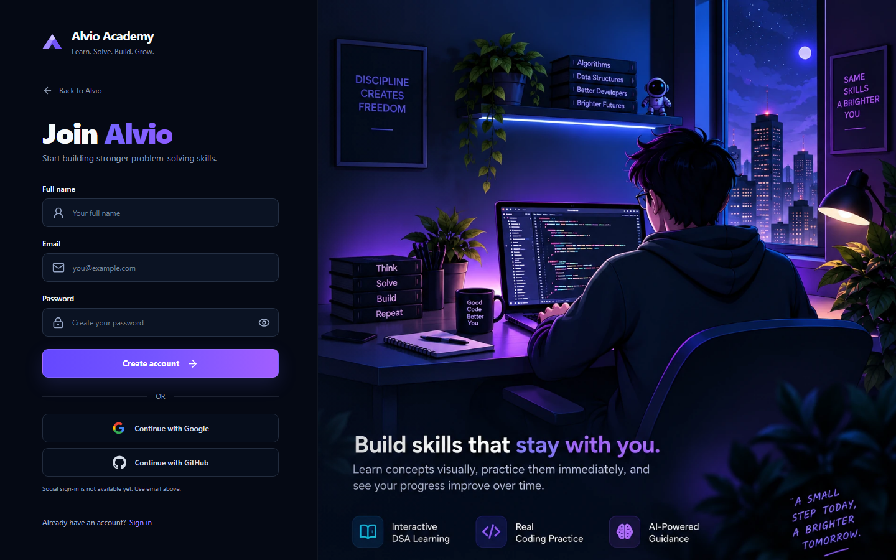
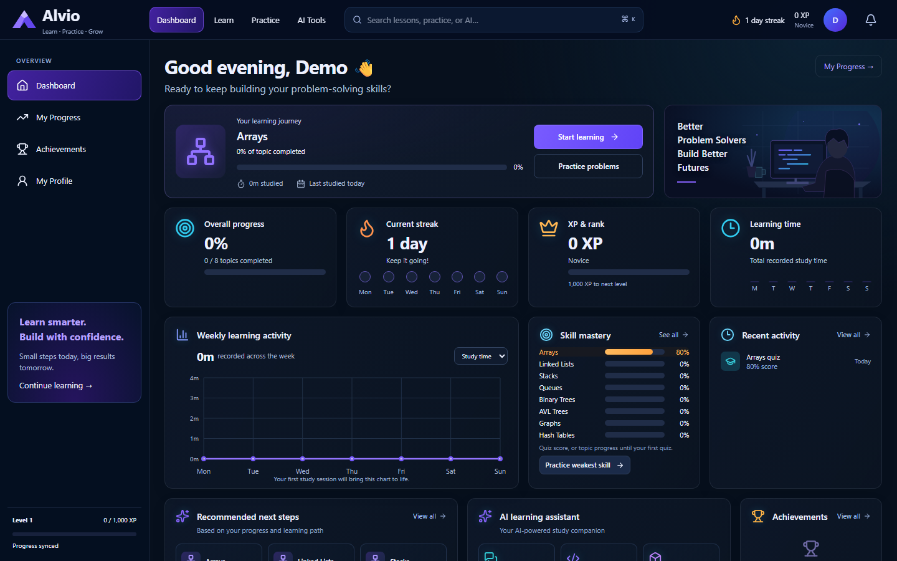
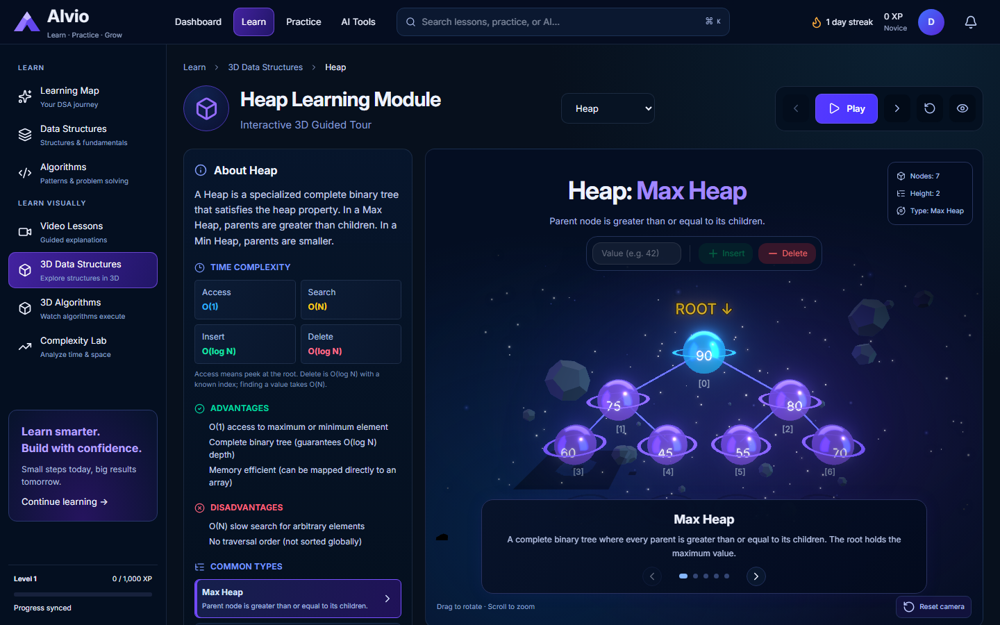
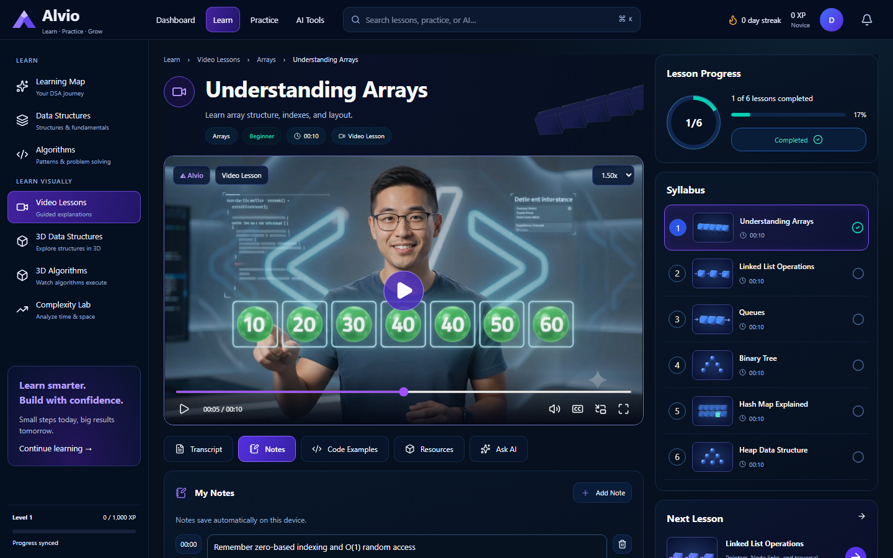
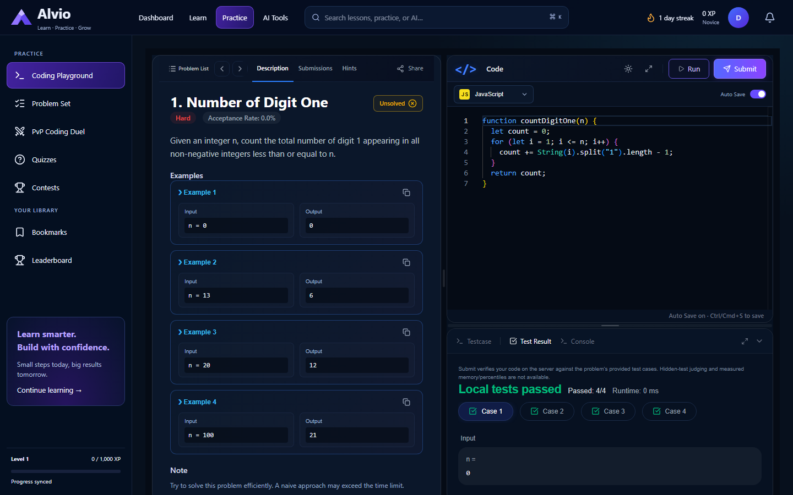
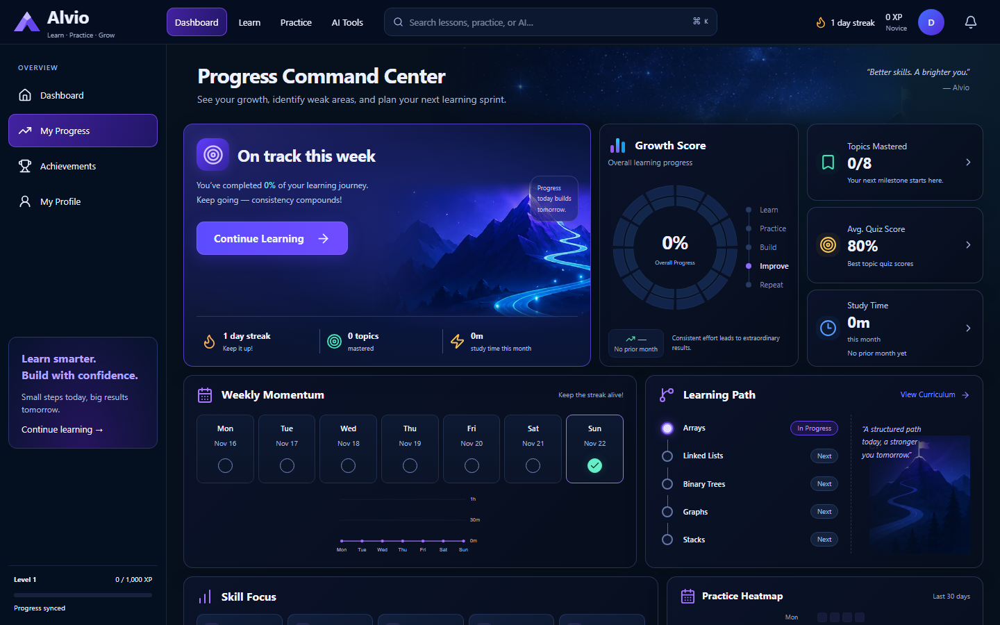
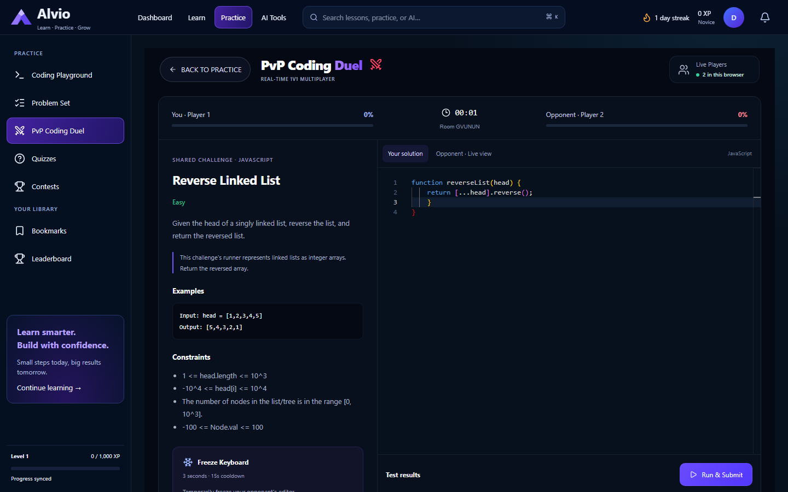
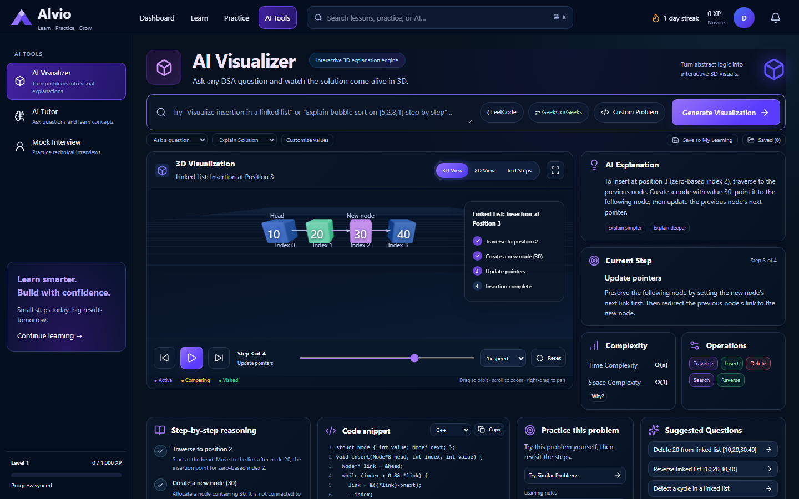
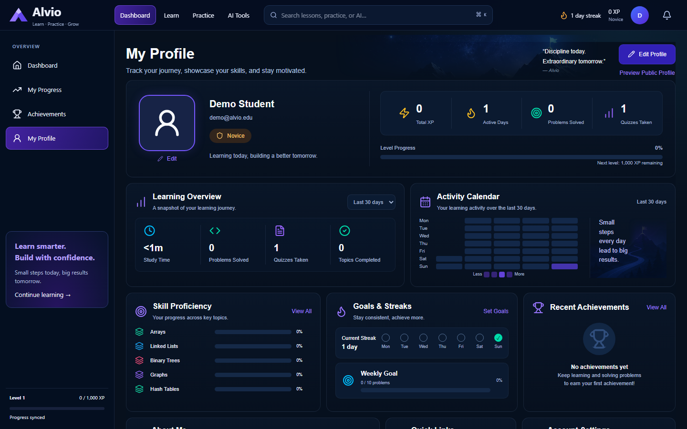

# ALVIO — INTERACTIVE DATA STRUCTURES AND ALGORITHMS LEARNING PLATFORM

---

## 1. Title Page

> **[Instructions for Student]:** Replace the bracketed placeholders below with your official university/college cover-page formatting and details before exporting to PDF or Word.

<div align="center">

### A PROJECT REPORT ON

# **ALVIO: AN INTERACTIVE DATA STRUCTURES AND ALGORITHMS LEARNING PLATFORM**

*Submitted in partial fulfillment of the requirements for the award of the degree of*

**[Degree Name — e.g., Bachelor of Technology / Bachelor of Science / Master of Computer Applications]**  
in  
**[Department Name — e.g., Computer Science and Engineering]**

Submitted by:  
**[Student Full Name]**  
**[University Roll Number / Registration Number]**

*(Add additional team members if applicable)*

Under the guidance of:  
**[Project Guide / Faculty Supervisor Name]**  
**[Guide Designation, Department Name]**

**[College / Institution Name]**  
**[University Name]**  
**[City, State — Academic Year 2025–2026 / 2026–2027]**

</div>

---

## 2. Abstract

Data Structures and Algorithms (DSA) form a core foundation of computer science education and technical interviews, yet students frequently struggle to connect abstract pointer manipulations, recursive calls, and memory structures to working source code. Existing study workflows are often fragmented across static textbooks, separate video websites, disconnected online compilers, and unverified self-study checklists.

**Alvio** is a full-stack web application designed to unify DSA conceptual learning, interactive 2D/3D visualization, guided practice, server-verified coding assessment, and optional AI tutoring inside a single consistent workspace. Built with **React 19**, **TypeScript**, **Vite 8**, **Three.js / React Three Fiber**, **Monaco Editor**, **Express 5**, and **Node.js 24 built-in SQLite (`node:sqlite`)**, Alvio organizes learning into four structured areas: **Dashboard**, **Learn** (interactive data structure guides, 3D and algorithm visualizers, and bundled video lessons), **Practice** (a 472-problem multi-language Coding Playground, configurable Quizzes, Progress Command Center, and a local two-tab PvP Coding Duel), and **AI** (streaming AI Tutor, step-by-step AI Visualizer, and Mock Interview simulator).

To ensure data integrity and offline usability, Alvio combines server-side authentication (`bcryptjs` password hashing and HS256 JSON Web Tokens) with an account-scoped **IndexedDB** offline cache and compare-and-swap cloud progress synchronization featuring three-way conflict resolution. In the Coding Playground, student code is never executed inside the Express process; instead, quick JavaScript experimentation runs in browser Web Workers, while server-verified submissions (`POST /api/problems/:problemId/submit`) load authoritative test cases from SQLite and delegate execution across seven supported programming languages to the external **Paiza.IO** execution API with per-run nonce verification.

The completed application was verified using an automated regression suite (`npm run test:demo`) achieving **0 lint errors**, a clean production build, **37/37 passing backend, authentication, sync, and server-verified submission tests**, **10/10 passing domain model and algorithm unit tests across 7 files**, and **13 passing Playwright end-to-end browser test scripts** (including **128/128** responsive viewport-by-route checks) without requiring paid live API keys during automated testing.

---

## 3. Introduction

Understanding how data structures store, organize, and manipulate information in memory is essential for writing efficient software. While introductory programming courses teach syntax and control flow, transitioning to topics such as linked-list pointer reassignments, heapify operations, balanced AVL tree rotations, graph traversals, and dynamic programming requires strong mental models.

Traditional classroom slides and printed textbooks present only static snapshots of inherently dynamic processes. When learners attempt to bridge this gap independently, they typically open multiple unrelated tools: video lectures in one tab, an algorithm animation website in another, a coding judge in a third, a flashcard or quiz site in a fourth, and a general-purpose chatbot in a fifth. Progress is lost between tools, offline study is difficult, and beginner coding websites often perform grading purely on the client side, which makes submission statistics easy to forge or break.

**Alvio** addresses this gap as a cohesive academic learning platform tailored for computer science students. Rather than replacing industrial competitive-programming infrastructure, Alvio focuses on **interactive intuition, clean full-stack engineering, reliable offline-first learning, transparent server-side verification, and graceful degradation** when external AI or code-execution APIs are unavailable.

---

## 4. Problem Statement

Computer science students learning Data Structures and Algorithms face four recurring obstacles:

1. **Lack of Dynamic Intuition:** Static diagrams and text descriptions make it difficult to follow step-by-step pointer mutations, tree balancing, heap percolations, and sorting partitions.
2. **Fragmented Learning Ecosystem:** Lessons, visualizations, video tutorials, quizzes, progress analytics, coding practice, and interview preparation live on separate platforms with inconsistent interfaces and no unified progress tracking.
3. **Unreliable Client-Side Practice Evaluation:** Simple educational coding playgrounds often run tests exclusively in the browser and trust client-submitted verdicts, allowing manipulated results and inaccurate problem acceptance rates.
4. **Fragile External Dependencies:** Many modern learning apps break completely during demonstrations or self-study when third-party CDNs, HDR assets, AI APIs, or internet connectivity become unavailable.

---

## 5. Objectives

The primary objectives of the Alvio project are:

1. **Unified Learning Environment:** Design and implement a single responsive web application bringing together Dashboard, Learn, Practice, and AI modules under one authenticated navigation shell.
2. **Interactive 2D/3D Visualizations:** Build interactive visualizations for core data structures (Arrays, Linked Lists, Stacks, Queues, Binary Trees, AVL Trees, Graphs, Hash Tables, Heaps) and classic algorithms that work offline using local procedural lighting.
3. **Structured Practice and Analytics:** Provide a 472-problem multi-language Coding Playground, bundled video lessons with timestamped notes, configurable quizzes (including timed and Rapid Fire modes), a local PvP practice duel, and a Progress Command Center.
4. **Secure Authentication and Offline-Capable Persistence:** Implement server-side `bcryptjs` + JWT authentication, SQLite schema migrations, IndexedDB offline caching, and optimistic-concurrency cloud progress synchronization.
5. **Safe Server-Verified Coding Submissions:** Verify coding submissions on the server against SQLite-stored test cases using an external sandboxed execution provider (Paiza.IO) without running `eval` or child processes on untrusted code inside the Express server.
6. **Optional AI Learning Assistance with Graceful Fallbacks:** Integrate server-proxied Groq AI capabilities (AI Tutor, AI Visualizer, Mock Interview) with strict input validation, rate limiting, and non-crashing fallbacks when offline or unconfigured.
7. **Reproducible Verification:** Validate the system end-to-end through automated backend, unit, and Playwright browser tests that run deterministically against temporary databases and mocked external providers.

---

## 6. Proposed Solution

Alvio is implemented as a modern single-repository full-stack TypeScript web application:

- **Frontend Client (`src/`):** A Single Page Application (SPA) built with React 19, TypeScript, React Router 7, Tailwind CSS, and Zustand. Interactive 3D scenes are rendered via Three.js / React Three Fiber / Drei, code editing uses locally bundled Monaco Editor, charts use Recharts, and animations use Framer Motion.
- **Offline Cache & Synchronization (`src/services/db.ts`, `progressSync.ts`, `mergeProgress.ts`):** Learning state updates immediately in Zustand, persists to an account-scoped IndexedDB store (with synchronous `localStorage` fallback), and synchronizes with the backend using revision numbers and three-way merging.
- **Backend Server (`server.ts`, `server/*`):** An Express 5 application running on Node.js 24. During development, Express mounts Vite in middleware mode on one port; in production, `esbuild` bundles the backend into `dist/server.cjs` and Express serves both the REST/SSE APIs and the compiled Vite bundle in `dist/`.
- **Relational Persistence (`server/db.ts`, `server/migrations.ts`):** Node.js 24's built-in `node:sqlite` (`DatabaseSync`) stores user accounts, profile data, learning progress snapshots, 472 seeded coding problems, server-verified submissions, problem statistics, interactions, and feedback in a single portable file (`data/database.sqlite`).
- **External Provider Integration (Server-Proxied):** Groq (`groq-sdk`) powers streaming AI Tutor replies, Mock Interview rubric feedback, and structured AI Visualizer scenes; Paiza.IO executes multi-language code for server-verified submissions and non-JavaScript Run requests.

---

## 7. System Architecture

Alvio follows a layered client-server architecture with a clear trust boundary between the browser and the Express backend:

```text
+-----------------------------------------------------------------------------+
|                        Browser Client (React + TypeScript)                  |
|                                                                             |
|  +-----------------------+   +---------------------+   +-----------------+  |
|  | AppLayout & AuthGuard |-->| Feature Modules     |-->| Zustand Stores  |  |
|  | (Public / Protected)  |   | Learn, 3D, Video,   |   | useAuthStore    |  |
|  +-----------------------+   | Coding, Quiz, PvP,  |   | useProgressStore|  |
|                              | AI Tutor, Interview |   +--------+--------+  |
|                              +----------+----------+            |           |
|                                         |                       v           |
|                              +----------+----------+   +-----------------+  |
|                              | Local Web Workers   |   | IndexedDB +     |  |
|                              | (JS Run & PvP Duel) |   | localStorage    |  |
|                              +---------------------+   | (Offline Cache) |  |
+-----------------------------------------+-----------------------+-----------+
                                          |                       |
                         Authenticated REST / SSE (/api/*)        |
                                          v                       v
+-----------------------------------------------------------------------------+
|                    Express 5 Backend (Node.js 24 / server.ts)               |
|                                                                             |
|  +-------------------------+   +-----------------------------------------+  |
|  | Security & Auth Layer   |   | Domain Route Handlers                   |  |
|  | - requireAuth /         |   | - /api/auth/* (signup, login, me)       |  |
|  |   optionalAuth (JWT)    |   | - /api/progress (CAS revision sync)     |  |
|  | - bcryptjs hashing      |   | - /api/problems/* & /submit             |  |
|  | - CORS, CSP, Headers    |   | - /api/profile, /dashboard, /leaderboard|  |
|  | - In-memory Rate Limits |   | - /api/chat (SSE), /api/visualizer      |  |
|  +-------------------------+   +--------------------+--------------------+  |
|                                                     |                       |
|            +----------------------------------------+--------------------+  |
|            v                                        v                    v  |
|  +--------------------+                  +--------------------+  +-------+  |
|  | SQLite (node:sqlite|                  | Groq SDK (Optional)|  | Paiza |  |
|  | WAL + Foreign Keys |                  | Llama 3.3 70B &    |  | .IO   |  |
|  | schema_migrations) |                  | Visualizer Model   |  | API   |  |
|  +--------------------+                  +--------------------+  +-------+  |
+-----------------------------------------------------------------------------+
```

### Key Architectural Principles

1. **Server-Owned Trust Boundary:** Passwords, JWT signing (`JWT_SECRET`), AI credentials (`GROQ_API_KEY`), authoritative coding test cases, submission verdicts, and permanent user XP (`users.xp`) remain strictly server-controlled.
2. **Session Bootstrap via `AuthGuard`:** Public routes (`/` and `/auth`) load immediately. Protected routes first verify the stored bearer token via `GET /api/auth/me` and hydrate learning progress before rendering private UI. Unauthenticated deep links are preserved via the `next` query parameter (with open-redirect validation in `authDestination`).
3. **Offline-First Learning with Explicit Trust Scope:** Previously verified, unexpired sessions with a cached snapshot can continue viewing local lessons, visualizers, videos, quizzes, and cached progress when the server is unreachable. Offline access is explicitly treated as client UI access—never as server authorization.
4. **Account Isolation:** Signing out waits up to 3 seconds to flush pending progress sync, cancels in-flight requests, and clears visible progress state. Local histories (tutor chats, mock interviews, coding drafts, PvP state) are keyed per account so switching accounts never leaks private data.

---

## 8. Technology Stack

| Layer | Technology | Version / Notes | Role in Alvio |
| --- | --- | --- | --- |
| **UI Framework** | React | `19.2.7` | Component-based SPA interface with lazy-loaded route code splitting |
| **Language** | TypeScript | `~6.0.2` | Static typing for shared frontend/backend domain models |
| **Build Tool & Dev Server** | Vite | `8.1.1` | Fast HMR dev server (Express middleware) and production asset bundling |
| **Routing** | React Router (`react-router-dom`) | `7.18.1` | Public landing/auth routing and `AuthGuard`-protected workspace routes |
| **State Management** | Zustand | `5.0.14` | Lightweight reactive stores (`useAuthStore`, `useProgressStore`) |
| **Styling & Motion** | Tailwind CSS, Framer Motion, Lucide React | `4.3.2` / `12.42.2` / `1.24.0` | Responsive dark UI layout, transitions, icons, and typography |
| **3D Visualization** | Three.js, React Three Fiber, Drei, Postprocessing, React Spring | `0.185.1` / `9.6.1` / `10.7.7` | Interactive 3D data structure and algorithm visualizers with offline procedural lighting |
| **Code Editor** | Monaco Editor (`@monaco-editor/react`) | `4.7.0` | Locally bundled IDE-grade code editor with local Vite worker |
| **Charts & Markdown** | Recharts, `react-markdown`, `remark-gfm` | `3.9.2` / `10.1.0` / `4.0.1` | Progress analytics charts and formatted AI Tutor / problem descriptions |
| **Layout Splitters** | `react-resizable-panels` | `4.12.2` | Resizable split-pane Coding Playground workspace |
| **Backend Runtime** | Node.js & Express | Node `24.13.0` / Express `5.2.1` | REST API, SSE streaming proxy, static bundle serving, security middleware |
| **Database** | Built-in `node:sqlite` (`DatabaseSync`) | Node.js 24 built-in | Zero-setup relational SQLite database with WAL mode and foreign keys |
| **Backend Bundler** | `esbuild` & `tsx` | `0.28.1` / `4.23.1` | TypeScript execution in dev and compact `dist/server.cjs` (`101.0 kb`) production bundle |
| **Auth & Security** | `bcryptjs`, `jsonwebtoken`, `cors` | `3.0.3` / `9.0.3` / `2.8.6` | Password hashing, HS256 JWT signing/verification, strict origin checks |
| **Client Offline Storage** | IndexedDB + `localStorage` | Browser APIs | Account-scoped offline learning snapshots, sync queue, and local drafts |
| **External AI Service** | Groq API (`groq-sdk`) | `1.3.0` | Optional LLM backend for AI Tutor, Mock Interview, and AI Visualizer |
| **External Code Runner** | Paiza.IO API | REST (`api.paiza.io`) | Sandboxed remote execution for server-verified Submit and non-JS Run |
| **Testing & Linting** | `node:test`, Playwright, `fake-indexeddb`, `oxlint` | Playwright `1.64.0`, `oxlint 1.71.0` | Automated lint, backend/unit suites, and cross-viewport browser regressions |

---

## 9. Module Descriptions

Alvio is organized into modular feature folders under `src/features/` and focused backend modules under `server/`:

1. **Landing & Authentication Module (`/`, `/auth`)**
   - Public landing page showcasing platform capabilities and the 472-problem catalog metric.
   - Unified signup and login workflow backed by `POST /api/auth/signup`, `POST /api/auth/login`, and `GET /api/auth/me`.
   - `AuthGuard` handles session verification, deep-link preservation (`next`), safe redirect validation, and offline fallback for previously verified unexpired sessions.

2. **Unified Navigation Shell & Dashboard (`/dashboard`, `/catalog`, `/skill-tree`)**
   - Consistent `AppLayout` sidebar/mobile drawer grouping routes into Dashboard, Learn, Practice, and AI.
   - Global command search (`Ctrl+K`) for rapid navigation across data structures, algorithms, and tools.
   - Dashboard displays user level, server-authoritative XP, recent learning momentum, sync status indicator (syncing, synced, unavailable, storage-error with retry), and resume actions.

3. **Data Structures & Algorithms Learning Module (`/learn/*`)**
   - Dedicated interactive concept guides for **Arrays**, **Linked Lists**, **Stacks**, **Queues**, **Binary Trees**, **AVL Trees**, **Graphs**, **Hash Tables**, and **Heaps** (`/learn/array` through `/learn/heap`).
   - Algorithm hubs covering **Sorting**, **Searching**, **Complexity 3D**, **Divide & Conquer**, **Dynamic Programming**, **Greedy**, and **Graph Algorithms**, plus an interactive **Skill Tree Map** (`/skill-tree`).

4. **Interactive 3D & Algorithm Visualizers (`/3d-visualizer`, `/algorithms-visualizer`)**
   - Real-time Three.js / React Three Fiber scenes supporting live operations (insert, delete, search, heapify, rotations, sorting passes) with play/pause, step-by-step playback, camera orbit/pan/zoom, and speed controls.
   - Uses local procedural `<Environment><Lightformer /></Environment>` lighting so all 3D visualizers run cleanly without external HDR CDN fetches.

5. **Video Learning Module (`/video-learning`)**
   - Bundled local DSA video lessons with adjustable playback speed, timestamped study notes, accompanying code examples, completion tracking, and automatic resume at the last watched timestamp.
   - Persists progress locally and syncs to SQLite across sessions.

6. **Coding Playground Module (`/coding`)**
   - Resizable split workspace featuring **472 seeded problems** from SQLite, searchable problem catalog, problem descriptions, examples, constraints, progressive hints, Monaco Editor, editable test cases, **Run** / **Run Testcase**, **Server-Verified Submit**, **Submissions** history tab, and problem interactions/feedback.
   - Supports 7 programming languages (`javascript`, `typescript`, `python`/`python3`, `cpp`, `c`, `java`, `csharp`) with auto-saved per-problem/per-language drafts.

7. **Quizzes & Progress Command Center (`/quiz`, `/progress`)**
   - Configurable DSA quizzes by topic, difficulty, question count, standard timed mode, and Rapid Fire mode, with post-quiz answer review and idempotent attempt tracking by stable ID.
   - Progress Command Center visualizes mastery percentages, daily/weekly study time, quiz performance, visualizer exploration, and cloud sync status via Recharts charts.

8. **PvP Coding Duel Module (`/workspace/pvp`)**
   - Interactive two-tab local coding duel over the browser's `BroadcastChannel` API.
   - One tab hosts a room and generates a 6-character room code; a second tab joins to share the same coding challenge (`reverseList`), view live opponent code progress, trigger a freeze power-up, and evaluate solutions in a dedicated Web Worker (`duelRunner.worker.ts`) to declare Victory.

9. **AI Learning Suite (`/ai-tutor`, `/learn/ai-visualizer`, `/mock-interview`)**
   - **AI Tutor:** Streaming SSE conversational DSA mentor supporting modes (`Teach me`, `Give me a hint`, `Quiz me`, `Review my code`), Markdown + copyable code blocks, file attachment reading, and local account-scoped chat history.
   - **AI Visualizer:** Converts problem statements into structured step-by-step scenes rendered in toggleable 2D/3D views with timeline scrubbing, synchronized code line highlighting, follow-up Q&A, and an offline built-in **Linked List: Insertion** walkthrough.
   - **Mock Interview:** Structured technical interview practice with topic/difficulty setup, typed/voice answers, private scratch notes (excluded from API requests), per-answer rubric feedback, final Markdown report, and graceful retry on API failures.

10. **Profile & Leaderboard Module (`/profile`, `/api/leaderboard`)**
    - Displays solved problem counts, submission statistics, favorites, and editable profile details (name, location, university, GitHub, LinkedIn, avatar URL), plus clean sign-out.

---

## 10. Database Design

Alvio uses **SQLite** via Node.js 24's built-in `node:sqlite` (`DatabaseSync`) with **Write-Ahead Logging (WAL)** and **Foreign Keys (`PRAGMA foreign_keys = ON`)** enabled. Schema evolution is managed deterministically by `server/migrations.ts`, which applies numbered transactional migrations (`BEGIN IMMEDIATE` / `COMMIT` / `ROLLBACK`) recorded in `schema_migrations`.

### Entity-Relationship Overview

```text
+------------------+       1:1 (CASCADE)      +-----------------------+
|      users       |------------------------->|   learning_progress   |
| PK id            |                          | PK/FK user_id         |
| UNIQUE email     |                          | progress_json         |
| password_hash    |                          | revision              |
| name, xp, level  |                          | updated_at            |
| profile fields   |                          +-----------------------+
+--------+---------+
         | 1:N                                +-----------------------+
         +----------------------------------->|   user_submissions    |
         |                                    | PK id                 |
         | 1:N  +-------------------------+   | FK user_id            |
         +----->| user_problem_interactions|  | FK problem_id         |
         |      | FK user_id, problem_id  |   | status, language, code|
         |      +-------------------------+   | passed/total, runtime |
         |                                    | verified (0 or 1)     |
         | 1:N  +-------------------------+   +-----------+-----------+
         +----->|   problem_feedback      |               | N:1
         |      | FK user_id, problem_id  |               v
         |      +-------------------------+   +-----------------------+
         |                                    |       problems        |
         | 1:N  +-------------------------+   | PK id                 |
         +----->| user_activity /         |   | title, topic,         |
                | course_progress         |   | difficulty, signature |
                +-------------------------+   | starterCode, testCases|
                                              +-----------+-----------+
                                                          | 1:1
                                                          v
                                              +-----------------------+
                                              |     problem_stats     |
                                              | PK/FK problem_id      |
                                              | accepted, submissions |
                                              +-----------------------+
```

### Table Summary

| Table Name | Primary Key | Purpose & Key Columns |
| --- | --- | --- |
| `schema_migrations` | `version` | Tracks applied migration numbers and `applied_at` timestamps so migrations run safely once. |
| `users` | `id` (`AUTOINCREMENT`) | Stores account credentials (`email` unique, `password_hash`), display `name`, server-owned `xp` (default `0`), `level` (default `'Apprentice'`), `created_at`, and profile fields (`location`, `university`, `github`, `linkedin`, `avatar_url`). |
| `learning_progress` | `user_id` (`FK -> users.id ON DELETE CASCADE`) | Stores one validated JSON progress snapshot (`progress_json`) per student along with optimistic-concurrency `revision` and `updated_at`. |
| `problems` | `id` (`TEXT`) | Stores the 472 seeded coding challenges: `title`, `topic`, `difficulty`, `description`, `examples`, `constraints`, `signature`, `starterCode`, and authoritative `testCases`. |
| `problem_stats` | `problem_id` (`FK -> problems.id`) | Tracks aggregate `accepted` and `submissions` counts updated strictly from server-calculated submission verdicts. |
| `user_submissions` | `id` (`AUTOINCREMENT`) | Persists signed-in coding attempts: `user_id`, `problem_id`, `status` (`Passed`/`Failed`/`Error`), `language`, `code`, `runtime_ms`, `memory_mb` (unused/null), `passed_testcases`, `total_testcases`, `verified` (`1` for server-verified, `0` for legacy), and `created_at`. |
| `user_problem_interactions` | `id` (Unique `user_id, problem_id, interaction_type`) | Tracks per-user problem bookmarks/favourites and likes. |
| `problem_feedback` | `id` (`AUTOINCREMENT`) | Stores student-submitted issue reports, optional ratings, and comments linked to a problem. |
| `user_activity` | `id` (`AUTOINCREMENT`) | Legacy activity log table retained for migration compatibility (client reward writes to `/api/activity` are disabled with HTTP `410`). |
| `course_progress` | `id` (Unique `user_id, course_name`) | Legacy/supplementary course progress table maintained across migrations. |

---

## 11. Implementation Details

### 11.1 Development & Production Build Pipeline
- **Development (`npm run dev`):** Runs `tsx --watch-path=src --watch-path=server.ts --watch-path=server server.ts`, mounting Vite in middleware mode inside Express so both the React frontend and `/api/*` endpoints share a single origin (default `http://localhost:3001` in `.env.example`, or `3000` if `PORT` is unset).
- **Production (`npm run build` && `npm start`):** `vite build` generates an optimized code-split frontend bundle in `dist/`, and `esbuild` compiles `server.ts` into `dist/server.cjs` (`101.0 kb`). Running `NODE_ENV=production node dist/server.cjs` serves both static assets and API routes.
- **Database Seeding:** Running `npx tsx server/migrateProblems.ts` initializes the SQLite database via `server/db.ts`, executes pending migrations, and seeds all **472 coding problems** deterministically.

### 11.2 Client State, Offline Caching & Three-Way Cloud Sync
All learning progress updates flow through `progressSync.ts` and `useProgressStore`:
1. **Immediate Local Persistence:** Changes update Zustand immediately and write to a per-account synchronous `localStorage` fallback plus transactional IndexedDB storage (`src/services/db.ts`, DB version 2, which removed obsolete credential/session object stores).
2. **Debounced & Triggered Sync:** Routine updates debounce for **2 seconds** before calling `PUT /api/progress`. Major completion events, page visibility changes, focus/reconnect events, and explicit sign-out trigger an immediate sync attempt.
3. **Compare-and-Swap & Three-Way Merge (`mergeProgress.ts`):** Every `PUT /api/progress` sends the client's `revision`. If another tab or device updated the cloud snapshot first, Express returns **HTTP `409 Conflict`** with the latest cloud snapshot instead of overwriting silently. The client then runs a three-way merge against its last acknowledged base:
   - Unchanged local fields follow cloud updates.
   - Cumulative counters add only unsynced local deltas.
   - Completed topic and visited sets are unioned.
   - Quiz attempts merge by stable ID so replayed syncs cannot duplicate credits.
   - Preferences and video positions follow the newer snapshot (allowing rewind/decrease).

### 11.3 Shared API Transport (`authApi.ts`)
All authenticated frontend calls route through `apiFetch` (`authenticatedFetch`), which attaches `Authorization: Bearer <token>` exclusively to same-origin `/api/` URLs. If any API returns **HTTP `401`**, `apiFetch` invalidates that exact session, aborts in-flight requests and SSE streams, clears visible progress, and redirects the user cleanly to `/auth`.

### 11.4 Local 3D Rendering & Monaco Bundling
- **3D Visualizers:** Use procedural lighting (`<Environment><Lightformer /></Environment>`) rather than remote HDR texture URLs, preventing WebGL crashes or missing reflections offline.
- **Monaco Editor:** Bundled locally via Vite workers (`src/services/monacoSetup.ts`), eliminating external CDN latency or failures during offline evaluation.

### 11.5 PvP Coding Duel Architecture
`PvPShowdown` connects two browser tabs on the same machine via the standard browser **`BroadcastChannel`** API. Host tabs generate a 6-character room code; joining tabs synchronize problem state, live opponent code previews, a temporary freeze power-up, and match completion. Code evaluation runs inside a dedicated Web Worker (`duelRunner.worker.ts`) invoking `executeJavaScriptInline()` directly with a 3-second timeout guard.

---

## 12. AI Integration

AI capabilities in Alvio are optional enhancements proxied exclusively through the Express backend so `GROQ_API_KEY` never reaches the browser:

| Endpoint | Auth & Rate Limit | Model / Mechanism | Purpose & Safeguards |
| --- | --- | --- | --- |
| `POST /api/chat` | `requireAuth`, **25 req/min** per IP & account | Groq SDK (`llama-3.3-70b-versatile`), Server-Sent Events (`text/event-stream`) | Powers **AI Tutor** (with server-enforced DSA tutor system prompt and mode controls), Video Ask-AI, Coding AI Analysis, and **Mock Interview** (using a dedicated `'Mock Interview'` `tutorMode` so interview rubric prompts are preserved). |
| `POST /api/visualizer` | `requireAuth`, **12 req/min** per IP & account | Groq SDK (`GROQ_VISUALIZER_MODEL`, default `openai/gpt-oss-120b`), structured JSON | Generates step-by-step data structure scenes for **AI Visualizer** (`/learn/ai-visualizer`), validated and repaired server-side before returning renderable 2D/3D steps and synchronized code lines. |

### AI Safeguards & Offline Resilience
- **Bounded Inputs & Cancellation:** Message lengths, conversation history counts, and problem statement sizes are strictly bounded before calling Groq. Upstream requests abort automatically on client disconnect or after a **60-second** timeout (including visualizer JSON repair attempts).
- **Privacy in Mock Interview:** Private scratch notes taken during a Mock Interview remain strictly in browser state and are never sent to `/api/chat`.
- **Safe Error Handling:** If `GROQ_API_KEY` is missing, rate-limited, or unreachable, Express returns a safe JSON error (HTTP `500`/`502`) without leaking keys or stack traces. Frontend components display inline alerts with a **Retry** button and keep typed user input intact. Furthermore, `/learn/ai-visualizer` ships with a built-in local **Linked List: Insertion** walkthrough so 2D/3D toggling, timeline scrubbing, and code-line highlighting remain demonstrable completely offline.
- **Retired Legacy Route:** The obsolete `/api/generate-trace` endpoint and its unrouted page were removed during cleanup.

---

## 13. Coding Playground and Execution Architecture

Alvio separates fast local experimentation (**Run**) from authoritative grading (**Submit**) while strictly refusing to run untrusted student code inside the Express process (`eval`, `new Function`, and `child_process` are never invoked on student submissions).

### 13.1 Run vs. Server-Verified Submit

| Aspect | **Run / Run Testcase** | **Server-Verified Submit (`POST /api/problems/:problemId/submit`)** |
| --- | --- | --- |
| **Test Cases Used** | Editable visible/custom test cases in the UI | Authoritative test cases loaded directly from SQLite `problems` table |
| **Payload Accepted** | Local editor code + custom cases | Only `{ code, language }` (client verdicts/counts/test cases ignored) |
| **Execution Engine** | Browser Web Worker (JS, 3s timeout); Paiza API (other 6 languages) | External **Paiza.IO API** for all 7 languages (15s timeout, 64 KB code limit) |
| **Verdict Integrity** | Convenience preview only | Server-generated runner wrapper with per-run cryptographic random nonce marker |
| **Database Impact** | None (no history or stats changed) | Saves `user_submissions` (`verified = 1`) for signed-in users & updates `problem_stats` |
| **Guest Support** | Full local / preview support | Supported via `optionalAuth`: returns verdict (`saved: false`) without fake accounts |

### 13.2 Server-Side Verification Workflow (`server/submissionRunner.ts`)
1. Client sends `POST /api/problems/:problemId/submit` with `{ code, language }`.
2. Express enforces rate limiting, validates code size (`<= 65,536` bytes) and language allowlist, and checks optional authentication (invalid supplied tokens are rejected with `401`, never silently downgraded to guest).
3. Express queries the problem's `signature` and `testCases` from SQLite.
4. `submissionRunner.ts` generates a language-specific test harness embedding a unique random **nonce marker** (via `node:crypto` `randomBytes`), ensuring student `console.log`/`print` statements cannot spoof a `"Passed"` output line.
5. Express submits the wrapped source code to Paiza (`POST /runners/create`), polls `GET /runners/get_details` up to the 15-second timeout, and classifies the outcome into `Passed`, `Failed`, or `Error` (`compilation`, `runtime`, `timeout`, `provider`, or `unsupported`).
6. If Paiza is unreachable, Express returns **HTTP `503`** (`status: 'Error'`, `errorType: 'provider'`, `saved: false`) so provider outages are never misreported as Wrong Answer or corrupt acceptance statistics.

### 13.3 Language Coverage
- **JavaScript (`javascript`), TypeScript (`typescript`), Python (`python`/`python3`):** Full server-verified Submit support across all **472 problems**.
- **C++ (`cpp`), Java (`java`), C# (`csharp`):** Supported for standard primitive, array, and matrix signatures; problems using `TreeNode` or nullable integer arrays return an explicit `unsupported` error rather than a false pass.
- **C (`c`):** Supported for primitive, string, `integer[]`, and `char[]` signatures; complex nested signatures return an explicit `unsupported` message on Submit while remaining available for exploration.

---

## 14. Authentication and Security

Alvio implements layered application security appropriate for a modern full-stack web system:

1. **Password Security:** Passwords are never stored in plaintext or cached in the browser. Signup (`POST /api/auth/signup`) normalizes email addresses, validates lengths, and hashes passwords server-side using **`bcryptjs`** (salted one-way hash). Login uses identical email normalization and `bcrypt.compare`.
2. **Strict JWT Configuration (`server/auth.ts`):**
   - Requires an explicit `JWT_SECRET` environment variable of **at least 32 characters**; server startup intentionally fails if missing or weak (no hardcoded fallback).
   - Tokens use **`HS256`**, numeric user ID in `sub`, `issuer: 'alvio'`, `audience: 'alvio-student'`, and a **7-day expiration**.
   - Every authenticated request re-verifies both token claims and active account existence in SQLite.
3. **Permanent XP Integrity:** Permanent account XP lives exclusively in `users.xp`. `PUT /api/progress` always overrides `authoritativeXp` with the server record and never trusts self-reported XP. Legacy `POST /api/activity` reward writes return **HTTP `410 Gone`**.
4. **Input Validation & Payload Limits:** Request bodies are capped at **512 KB** (and coding submissions at **64 KB**). Progress snapshots validate nesting depth, map/array bounds, string lengths, numeric ranges, and reject prototype-pollution keys.
5. **Rate Limiting:** In-memory per-process rate limits protect sensitive endpoints:
   - Signup: **5 requests / 10 minutes** per IP
   - Login: **10 requests / 10 minutes** per IP
   - AI Chat: **25 requests / minute** per IP & account
   - AI Visualizer: **12 requests / minute** per IP & account
   - Progress Sync: **120 requests / minute** per IP & account
   - Coding Submit: dedicated per-user/IP submission limiter
6. **HTTP Security Headers & CORS:** Production requires explicit `ALLOWED_ORIGINS`. Responses set `X-Content-Type-Options: nosniff`, `X-Frame-Options: DENY`, `Referrer-Policy`, and a scoped Content Security Policy (CSP).
7. **Structured Safe Logging:** Server logs record request ID, route, duration, status, and account ID while omitting credentials, student conversations, and raw upstream provider secrets.

---

## 15. Testing Methodology

To guarantee reliability without spending money on live AI or execution APIs during automated verification, Alvio employs a multi-layer testing pyramid executed through a single unified command (`npm run test:demo`):

1. **Static Analysis & Build Verification:**
   - `npm run lint` (`oxlint`) verifies zero lint errors across frontend and backend code.
   - `npm run build` validates both the Vite client bundle and the `esbuild` Express server bundle.
2. **Backend Integration & Security Tests (`npm run test:foundation` via `node:test`):**
   - Runs against isolated temporary SQLite databases and disposable JWT secrets (never touching `data/database.sqlite`).
   - Covers JWT validation/rejection, account ownership checks, CORS & security headers, rate and body limits, repeatable database migrations, `PUT /api/progress` 409 conflict & three-way merge, offline sync recovery, `optionalAuth`, and all server-verified coding submission outcomes using a mocked execution provider.
3. **Domain Model & Algorithm Unit Tests (`npm run test:models` via `node:test`):**
   - Validates pure TypeScript/JavaScript logic including safe redirect validation (`auth-destination`), dashboard metrics, practice filters, progress analytics, quiz scoring/idempotency, 480 deterministic binary heap operations, and visualizer progress tracking.
4. **End-to-End Browser Regressions (`Playwright` Chromium):**
   - Launches the built application against an isolated temporary server and SQLite database, deterministically mocking `/api/chat`, `/api/visualizer`, and Paiza responses where needed.
   - Verifies real browser flows across desktop (`1920px` / `1440px`) and mobile (`390px`) viewports: signup/login/deep-link protection, profile updates, Monaco coding Run/Submit/History/timeout/language switching, 128 route-by-viewport navigation checks, real bundled video playback and resume, AI Tutor SSE + retry, AI Visualizer 2D/3D/timeline/code sync, Quiz + Rapid Fire, Progress Command Center, two-tab PvP Duel, and Mock Interview SSE + rubric + private notes + report.
5. **Operational Smoke & Offline Fallback Checks:**
   - Independently verifies fresh catalog seeding (`472` problems), dev & production server startup, offline provider failure responses (`500`/`502`/`503`), and zero `pageerror`/horizontal overflow on landing and 3D visualizers.

---

## 16. Verified Test Results

All results below were verified on **2026-11-22** on commit `e124262` (`main` branch) running **Node.js `v24.13.0`** and **npm `11.19.0`**, as recorded in [docs/final-verification-results.md](./final-verification-results.md).

| Stage / Verification Check | Command | Status | Verified Result |
| --- | --- | --- | --- |
| **Static Linting** | `npm run lint` (`oxlint`) | **PASS** | `0` errors (pre-existing unused-variable warnings remain) |
| **Production Build** | `npm run build` | **PASS** | Vite client built in `2.79s`; Express `dist/server.cjs` (`101.0 kb`) built in `19ms` |
| **Backend, Auth, Sync & Submission Tests** | `npm run test:foundation` | **PASS** | **37/37 tests passed**, `0` failed (`2427ms`) |
| **Domain Model & Algorithm Unit Tests** | `npm run test:models` | **PASS** | **10/10 tests passed** across 7 files (incl. `480` heap ops), `0` failed (`713ms`) |
| **Auth Foundation Browser Suite** | `npm run test:auth-browser` | **PASS** | **3/3 tests passed**, `0` failed (`9428ms`) |
| **Auth, Profile & Coding Regressions** | `npm run test:auth-regressions` | **PASS** | **4/4 browser scripts passed** (auth, profile, Monaco Run/Submit/History/timeout, 8 picker language symbols) |
| **Learning, Video & AI Browser Suite** | `npm run test:learning-browser` | **PASS** | **4/4 browser scripts passed** (**128/128** viewport × route checks from `1920px` to `390px`, `0` failures) |
| **Practice, Quiz, Progress, PvP & Interview** | `npm run test:practice-browser` | **PASS** | **4/4 browser scripts passed** (Quiz/Rapid Fire, Progress, 2-tab PvP Duel, Mock Interview SSE/rubric/notes/report) |
| **Fresh Database Catalog Seeding** | `npx tsx server/migrateProblems.ts` (temp DB) | **PASS** | Seeded **472** coding problems cleanly into SQLite |
| **Dev & Production Server Smoke Checks** | `tsx server.ts` & `node dist/server.cjs` | **PASS** | `/` → `200`, `/api/problems` → `200` (472 problems), `/api/auth/me` → `401` |
| **Offline Provider Fallback Verification** | Empty `GROQ_API_KEY`, unreachable `PAIZA_API_BASE` | **PASS** | `/api/chat` → safe `500`; `/api/visualizer` → safe `502`; `/api/problems/:id/submit` → `503` (`errorType: 'provider'`, `saved: false`) |
| **Landing & 3D/Algorithm Visualizers Check** | Desktop (`1440px`) & Mobile (`390px`) | **PASS** | `472` problem metric shown, `0` horizontal overflow, `0` `pageerror`s |

### Summary Metrics
- **Total Automated Backend & Unit Tests Passed:** **47** (`37` foundation/backend/submission + `10` model/unit)
- **Total Playwright E2E Browser Scripts Passed:** **13** (`1` TypeScript auth foundation suite + `12` comprehensive feature regression scripts)
- **Live Paid API Dependency During Testing:** **0** (100% deterministic local/mocked execution)

---

## 17. Screenshots

The ten screenshots below were captured directly from the running Alvio production build (`NODE_ENV=production node dist/server.cjs`) against an isolated temporary SQLite database seeded with all 472 coding problems using a demo account (`Demo Student`, `demo@alvio.edu`) with sample progress (no private personal details, real passwords, or API keys are exposed).

### Figure 17.1: Landing Page (`/`)
Public landing page displaying Alvio branding, feature highlights, and the live **472** coding problems metric.



### Figure 17.2: Authentication Page (`/auth`)
Public Sign Up / Sign In page backed by server-side `bcryptjs` password hashing and HS256 JWT issuance.



### Figure 17.3: Student Dashboard (`/dashboard`)
Authenticated student dashboard showing the four-pillar navigation shell, global search (`Ctrl+K`), streak, Arrays skill mastery (`80%`), recent quiz activity, and synced cloud status.



### Figure 17.4: Interactive 3D Heap Visualizer (`/3d-visualizer?ds=Heap`)
Interactive Three.js / React Three Fiber Max Heap scene rendered offline with local procedural lighting alongside time-complexity details and insert/delete controls.



### Figure 17.5: Video Learning with Timestamped Notes (`/video-learning`)
Bundled local DSA video lesson (*Understanding Arrays*) at `1.50x` playback speed with lesson completion (`1/6`) and a persisted timestamped note.



### Figure 17.6: Coding Playground (`/coding?problem=number-of-digit-one`)
Resizable split workspace featuring locally bundled Monaco Editor, language picker, Run/Submit controls, passing local Web Worker test output (`Passed: 4/4`), and the documented server-verification scope notice.



### Figure 17.7: Progress Command Center (`/progress`)
Cloud-synced learning analytics displaying streak, average quiz score (`80%`), weekly momentum, learning path progression, and synced status.



### Figure 17.8: Two-Tab PvP Coding Duel (`/workspace/pvp`)
Active two-player local duel synchronized across two tabs in the same browser (`Live Players: 2 in this browser`) via `BroadcastChannel`, showing the shared *Reverse Linked List* challenge, live opponent tab, Monaco Editor, and Freeze Keyboard power-up.



### Figure 17.9: AI Visualizer (`/learn/ai-visualizer`)
Built-in offline *Linked List: Insertion at Position 3* 3D/2D walkthrough displaying interactive 3D nodes, playback timeline (`Step 3 of 4`), explanation panel, complexity summary, and synchronized code snippet.



### Figure 17.10: Student Profile Page (`/profile`)
Authenticated student profile view (`Demo Student`) showing active days, quizzes taken, 30-day activity calendar, streak tracking, and synced progress status.



---

## 18. Limitations

To maintain academic honesty and clear engineering boundaries, the following limitations of the current college-project implementation are explicitly acknowledged:

1. **Visible Test Cases Only (No Hidden-Test Container Judge):** Server-verified Coding Submit evaluates each problem's provided SQLite test cases through the external Paiza.IO API. Alvio does not implement a LeetCode-style private Docker/container judge with hidden stress tests, nor does it measure memory usage or runtime percentiles.
2. **External API Dependency for Live AI and Non-JS/Submit Execution:** Live AI Tutor, Mock Interview, AI Visualizer generation, and server-verified Coding Submit require internet connectivity (plus `GROQ_API_KEY` for AI features).
3. **Local-Only PvP Coding Duel:** The PvP Coding Duel synchronizes across tabs in the same browser via `BroadcastChannel` as a local practice demonstration; it is not a networked internet multiplayer game over WebSockets.
4. **Authentication & Single-Process Limits:** Authentication stores bearer tokens in browser storage (requiring strict same-origin script security) rather than HttpOnly cookies with refresh/revocation tokens. Password reset and email verification are intentionally unavailable. Rate limits are stored in memory per Node.js process and reset on restart.
5. **Self-Reported Learning Analytics & Permanent XP:** Learning statistics (video watch time, quiz completions, topic reads) are self-reported snapshots synchronized with conflict resolution, not audited exam proctoring records. Permanent `users.xp` is protected on the server, and an automated server-verified XP reward ledger is deferred to future work.
6. **Legacy TypeScript Diagnostics & Minor Dependency Advisories:** While `oxlint`, `vite build`, `esbuild`, and all automated tests pass with `0` errors, running full `npx tsc -p tsconfig.app.json --noEmit` still reports pre-existing legacy diagnostics in untouched older UI files, and `npm audit` retains four low/moderate upstream advisories in Monaco DOMPurify and Tailwind selector-parser chains (zero high/critical vulnerabilities).

---

## 19. Future Scope

Building on Alvio's clean modular architecture, future work could expand the platform in the following directions:

1. **Containerized Hidden-Test Judge:** Introduce isolated Docker/Firecracker execution workers supporting private hidden test suites, strict CPU/memory quotas, and measured memory/runtime analytics.
2. **Networked Multiplayer PvP:** Replace `BroadcastChannel` with a WebSocket backend (e.g., Socket.IO or native `ws`) for real-time matchmaking, spectator mode, and cross-device coding duels.
3. **Server-Verified Learning Reward Ledger:** Implement an idempotent, event-validated XP and badge ledger linking verified coding submissions, proctored quizzes, and milestone completions directly to `users.xp`.
4. **Enhanced Account Lifecycle & Session Hardening:** Add HttpOnly cookie sessions with refresh-token rotation/revocation, SMTP-backed email verification, and secure password reset flows.
5. **Distributed Scalability:** Migrate from single-file SQLite and in-memory rate limiters to PostgreSQL and Redis when scaling beyond single-instance academic deployment.
6. **Instructor & Classroom Tools:** Add faculty dashboards for assigning problem sets, viewing anonymized class mastery heatmaps, and exporting student completion reports.

---

## 20. Conclusion

**Alvio** achieves its core academic goal of transforming Data Structures and Algorithms study from a fragmented, static process into an engaging, unified full-stack learning experience. By combining interactive Three.js 3D visualizers, bundled video lessons, configurable quizzes, offline-capable IndexedDB/SQLite progress synchronization, a 472-problem multi-language Coding Playground with nonce-protected server-side submission verification, a two-tab PvP duel, and optional server-proxied AI tools, the platform demonstrates solid full-stack engineering principles across frontend, backend, database, security, and automated testing.

With **0 lint errors**, **37/37 backend/submission tests**, **10/10 model unit tests**, and **13 passing Playwright browser regression suites** (verified without live paid API keys), Alvio is complete, well-documented, offline-resilient, and ready for academic evaluation and viva defense.

---

## 21. References

1. **React Documentation** — Meta Open Source. *React 19 Reference & Hooks API*. https://react.dev/
2. **TypeScript Documentation** — Microsoft. *TypeScript Language Specification & Handbook*. https://www.typescriptlang.org/docs/
3. **Vite Documentation** — Evan You & Vite Contributors. *Vite 8 Next Generation Frontend Tooling*. https://vite.dev/
4. **Express.js Documentation** — OpenJS Foundation. *Express 5 API Reference*. https://expressjs.com/
5. **Node.js Built-in SQLite (`node:sqlite`)** — Node.js Foundation. *Node.js v24 Documentation*. https://nodejs.org/api/sqlite.html
6. **Three.js & React Three Fiber** — Mr.doob & Poimandres. *Three.js Documentation & R3F Docs*. https://threejs.org/docs/ and https://r3f.docs.pmnd.rs/
7. **Monaco Editor** — Microsoft. *Monaco Editor Browser Code Editor*. https://microsoft.github.io/monaco-editor/
8. **Zustand State Management** — Poimandres. *Zustand Documentation*. https://zustand-demo.pmnd.rs/
9. **RFC 7519 — JSON Web Token (JWT)** — M. Jones, J. Bradley, N. Sakimura, IETF, 2015. https://datatracker.ietf.org/doc/html/rfc7519
10. **OWASP Password Storage & Authentication Cheat Sheets** — OWASP Foundation. https://cheatsheetseries.owasp.org/
11. **Groq API Documentation** — Groq Inc. *GroqCloud API & SDK Reference*. https://console.groq.com/docs/
12. **Paiza.IO Code Execution API** — Paiza Inc. *Paiza.IO API Documentation*. https://paiza.io/en/projects/new
13. **Playwright End-to-End Testing** — Microsoft. *Playwright Documentation*. https://playwright.dev/
14. **Introduction to Algorithms (CLRS), 4th Edition** — T. H. Cormen, C. E. Leiserson, R. L. Rivest, C. Stein, MIT Press, 2022.
